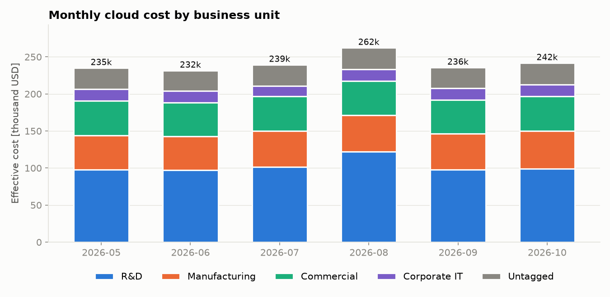
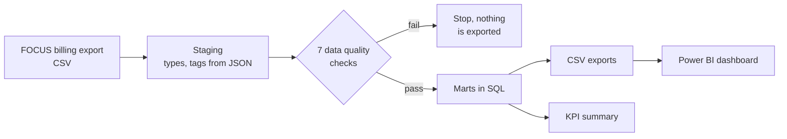
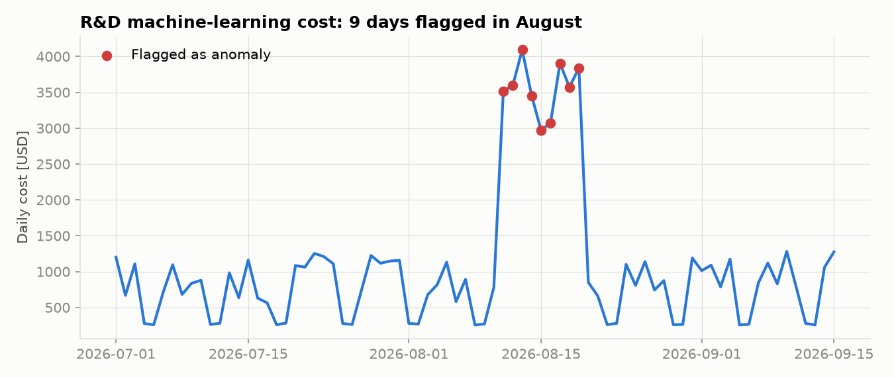

# Cloud cost analysis (FinOps)

A small FinOps pipeline: it takes a cloud billing export in the [FOCUS](https://focus.finops.org/) format, checks the data, builds reporting tables with SQL, and exports them for a Power BI dashboard. On top of it there is a findings memo for leadership and a short guide for business teams.

The billing data is synthetic: six months of AWS and Azure usage for a fictional pharma company, about 11,400 charge lines, $1.45 million in total. It contains the situations a FinOps team deals with: untagged resources, prepaid commitments, a credit, a cost spike, and machines nobody switches off.



## What it found

| Finding | Per year |
|---|---|
| 14 non-production VMs run 24/7 | about $271,000 saved if scheduled |
| AWS commitment covers only 18.7% of compute | about $110,000 saved with a larger plan |
| Azure reservation is 30% unused | about $53,000 saved by widening its scope |
| 12% of usage has no business unit tag | $340,000 cannot be attributed |
| GPU spike on 9 days in August | $23,414 above normal, one-off |

Details, method and what I'm less sure about: [docs/FINDINGS.md](docs/FINDINGS.md).

## How it works



- **Staging** (`sql/01_staging.sql`): casts types and pulls `business_unit`, `environment`, `application` and `owner` out of the FOCUS `Tags` JSON. Resources without a business unit become "Untagged".
- **Marts** (`sql/02`–`07`): monthly cost, tag coverage, commitment utilisation and coverage, daily cost with anomaly detection, always-on non-production machines, and a KPI table.
- **Data quality** (`pipeline/quality.py`): one currency, charges inside their billing period, no negative usage, committed rows name their commitment, no duplicate lines, billed and effective cost reconcile, and the marts add up to the source. If a check fails, the run stops before anything is exported.

SQL runs in DuckDB, so there is nothing to install besides Python. The SQL is plain enough to move to BigQuery or another warehouse with small changes.

## Two things worth knowing about the numbers

**Billed and effective cost.** A commitment is billed once a month but used every day. The pipeline reports effective cost, where the fee is spread over the usage it covered and the unused part is shown separately. A test checks that the two totals match over the period, and that purchases are not counted twice.

**Anomaly detection, second version.** The first rule was "more than 3 standard deviations above the 14-day average". It flagged only 2 of the 9 days of the August spike, because after two days the spike had pulled the average and the standard deviation up with it. The current rule compares each day with the median of the previous 28 days, which a spike barely moves. It flags all 9 days and nothing else in the six months.



## Run it

```
py -3.13 -m venv .venv
.venv\Scripts\activate             
pip install -r requirements.txt

python -m pipeline.run             quality checks, marts, CSV exports to output/, KPI summary
pytest                             12 tests
python scripts/charts.py           redraw the charts in docs/img
python generator/make_billing.py   regenerate the billing data
```

## Project structure

```
data/         focus_billing.csv, the billing export
generator/    creates the synthetic data
sql/          staging and marts
pipeline/     runner and data quality checks
scripts/      charts
docs/         findings, team guide, Power BI guide
tests/        pipeline and data quality tests
```
