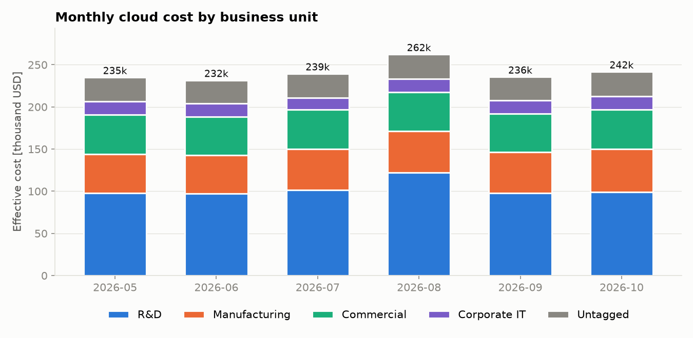
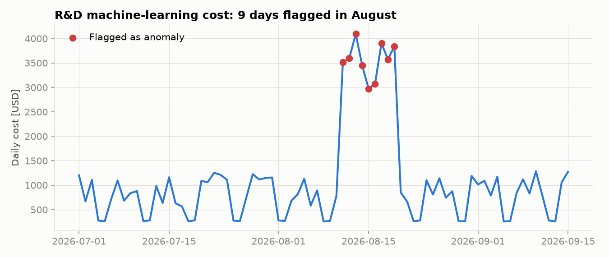

# Cloud cost review, May to October 2026

For: Digital and business unit leadership of Helix Pharma (a fictional company; the data is synthetic).

**In short:** cloud spend is stable at about $240,000 a month, $1.45 million over six months. Three changes would save about $434,000 a year, and two further issues need attention. The two largest savings need no engineering work: switching non-production machines off outside working hours, and buying a larger AWS commitment for workloads that run all the time.

| # | Finding | Evidence | Action | Estimated effect per year |
|---|---|---|---|---|
| 1 | 14 non-production VMs run 24/7 | Weekend cost equals weekday cost for 9 sandbox and 5 Commercial dev VMs | Schedule them for 12 hours on weekdays | about $271,000 saved |
| 2 | AWS commitment covers only a fifth of compute | Savings Plan is 100% used but covers 18.7% of compute; production runs at least $2,050 a day at list price, every day | Raise the commitment to 80% of the steady production level | about $110,000 saved |
| 3 | Azure reservation is 30% unused | Utilisation 70.4%; $15,957 of paid commitment unused in six months, while 4 CRM production VMs pay full price | Widen the reservation's scope so the CRM VMs can use it | about $53,000 saved |
| 4 | 12% of usage has no business unit tag | $170,283 in six months, all in the two sandbox accounts (11 resources) | Require tags in sandbox accounts; assign an owner per account | $340,000 a year becomes attributable |
| 5 | One GPU spike in August | 9 days, 11–19 August, $23,414 above the normal level | Budget alert on the R&D machine-learning account | One-off; faster detection next time |

Also worth watching: the Manufacturing data lake grew from $13,400 to $18,300 a month (+37% in five months). At this rate it doubles in about a year. Moving older data to a cheaper storage tier should be checked with the plant data team.

## How the estimates were made

- **Finding 1:** a machine is "always on" if its average weekend cost is more than 90% of its weekday cost. Running 60 of 168 hours a week saves 64% of its cost. The six-month figure ($135,475) is doubled for a year.
- **Finding 2:** AWS production compute never dropped below $2,053 a day at list price. The current plan covers about $555 of that. Committing to 80% of the floor covers a further $1,087 a day at the plan's 28% discount.
- **Finding 3:** the unused $15,957 would have covered $26,595 of on-demand usage at the reservation's 40% discount. Doubled for a year.
- **Finding 5:** each day is compared with the median of the previous 28 days.

## What I am less sure about

- **Finding 1** assumes none of the 14 machines needs to run at night, for example for batch jobs or teams in other time zones. The owners have to confirm, and the sandbox machines have no owner tag to ask.
- **Finding 2** assumes the production workload stays at this level for the commitment term. A planned migration would change the answer.
- **The spike** may have been planned work. The data shows when and how much, not why.

